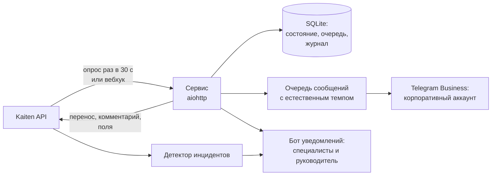

# support-relay

> Kaiten → Telegram automation for an L2 support team: auto-takes tickets, greets the client from the corporate Telegram account, tracks SLA and detects incidents across the whole board.

Сервис для L2-поддержки, который убирает ручную рутину между трекером заявок **Kaiten** и **корпоративным Telegram-аккаунтом** поддержки.

Я сделал его для своей работы в техподдержке онлайн-школы. Сначала он работал только на моих заявках, потом я показал его руководству и подключил к нему всю команду: один бот на корпоративном аккаунте обслуживает нескольких специалистов.

---

## Какую проблему решает

Раньше на каждую заявку специалист вручную делал одно и то же: перенести карточку в «В работе», написать комментарий, открыть Telegram, найти автора, поздороваться, назвать номер заявки, следить за сроком. На это уходили минуты, и время первой реакции зависело от того, насколько человек загружен.

Теперь это делает сервис, а специалист сразу переходит к решению проблемы.

## Что умеет

**Заявки**
- берёт назначенную заявку из «Очереди»: переносит в «В работе», оставляет публичный комментарий в Kaiten
- пишет автору заявки и клиенту с корпоративного аккаунта через официальный Telegram Business; на втором уровне — клиенту, а куратору короткое «взял, пишу клиенту»
- проверяет перед отправкой, что заявка всё ещё твоя и ты не ответил сам, чтобы не было лишних и двойных сообщений
- уважает смену: вне рабочего времени не берёт заявки сам, а присылает кнопку «Взять сейчас»

**SLA и порядок**
- напоминание при 80% срока и сигнал при просрочке
- «проблема актуальна?» — один раз, если клиент замолчал в ожидании ответа
- автоперенос в «В работе», когда специалист написал клиенту, и подсказка «перенеси в ожидание», когда клиент молчит
- режим честного времени реакции: заявка считается взятой, когда специалист её оценил, а не когда бот поздоровался

**Для команды и руководителя**
- **детектор инцидентов**: раз в минуту смотрит всю доску и сообщает о массовом сбое (три похожие заявки за 30 минут), всплеске, завале на уровне и заявках коллег без ответа
- итоги дня, отчёты за неделю и месяц, журнал действий бота по любой заявке
- **похожие решённые заявки**: «такое уже было — тогда помогло вот это», база собирается из выгрузки Kaiten с очисткой персональных данных
- **быстрые ответы**: шаблонные фразы в Telegram сами закрывают заявку и заполняют поля категории в Kaiten
- статистика проверок ПК перед уроком из [lesson-check](https://github.com/luciuverus/lesson-check)

## Архитектура



| Модуль | Что делает |
|---|---|
| `service.py` | основная логика: взять заявку, поставить сообщения в очередь, следить за SLA |
| `kaiten.py` | клиент Kaiten API |
| `transports.py` | отправка через Telegram Business (или Telethon для userbot-режима) |
| `incidents.py` | детектор массовых сбоев, завалов и заявок без ответа |
| `team.py` | один бот на несколько специалистов со своими сменами |
| `similar.py` | поиск похожих решённых заявок |
| `assess.py` | честное время реакции |
| `reports.py` | отчёты за неделю и месяц |
| `setup_wizard.py` | мастер первой настройки: сам находит колонки, id и chat id |

## Техническая сторона

| | |
|---|---|
| Стек | Python 3.10+, asyncio, aiohttp, SQLite, Telegram Bot API (Business), Kaiten REST API |
| Объём | 19 модулей, около 7 500 строк |
| Тесты | 343 автотеста на фейковых Kaiten и Telegram, без сети |
| Запуск | Windows (`start.bat`, автоперезапуск, автозапуск), macOS (`start.command`), Docker |
| Надёжность | состояние переживает перезапуск, второй экземпляр не стартует, тестовый режим `DRY_RUN` без отправки |
| Данные | токены только в `.env`, в журнале вычищаются; сообщения хранятся 60 дней, прочее — 90 |

## Запуск

```bash
cp .env.example .env      # или мастер настройки сделает это сам
pip install -r requirements.txt
python -m app.setup_wizard
python -m app.main
```

Подробная инструкция: [docs/SETUP.md](docs/SETUP.md).

## Как сделан

Задачи, правила работы и сценарии — мои: из ежедневной работы на второй линии и регламента поддержки. Код написан итеративно вместе с AI-ассистентом (Claude); я проверял каждую версию на живых заявках и решал, что бот должен и чего не должен делать.

Репозиторий обезличен: реальные домены, идентификаторы досок, имена и контакты заменены примерами.

**Улугбек Маткаримов** · [LinkedIn](https://www.linkedin.com/in/ulugbek-matkarimov-304a6b230) · Telegram [@luciuverus](https://t.me/luciuverus)
